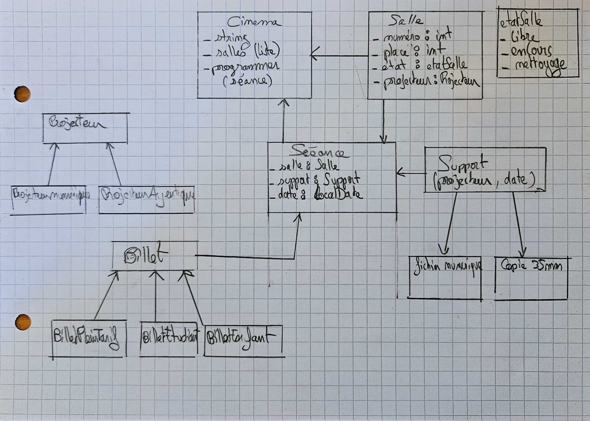

# Glossaire

## 1) Entités

1. Cinéma : la racine, qui regroupe les salles et les scéances.
2. Salle : nombre de personne dans une salle, chacune à son numéro, et un projecteur.
3. Projecteur : deux type : les numériques et les argentiques.
4. Film : un titre et une durée (en minutes).
5. Support : film numérique (DCP), la copie 35mm lisible que par les argentiques.
6. Séance : projection d'un support de film dans une salle, à une date donnée, avec un tarif.
7. Billet : 3 types de billet.

## 2) Comportements

- Programmer : séance.
- Vendre : billet.
- Début : la séance.
- Fin : la séance.
- Fin nettoyage.

## 3) Règles

### Salles

- On début une séance que dans un salle Libre.
- On fini le nettoyage que dans une salle Nettoyage.
- Le nombre de billet vendu ne peux pas dépasser le nombre de place dans une salle.

### Support

- Un support doit correspondre au projecteur de la salle (ex. : fichier numérique → projecteur numérique).
- Une copie de 35mm à une limite de 50 projections.
- Un fichier numérique ne peux pas être lu si il dépasse la date d'expiration de la clé de lecture.

### Programmation

- Le cinéma ne peux pas programmer une scéance dans un salle qui ne lui appartient pas.

## 4) États

- Libre
- En cours
- Nettoyage

## Diagramme de Classes

